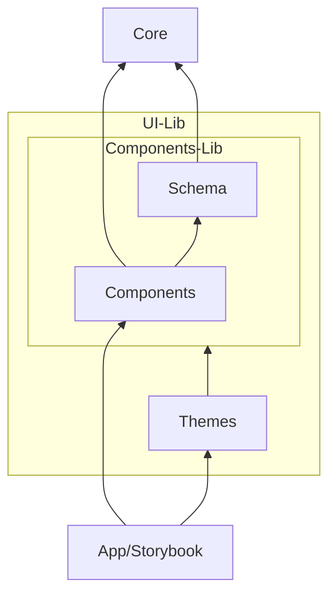
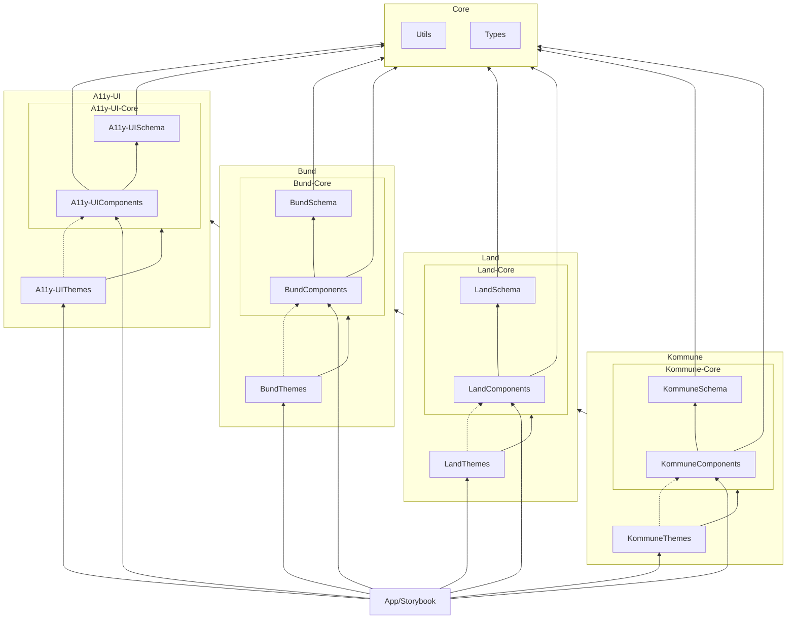

#

```bash
  ,---.    ,--.  ,--.                   ,--. ,--. ,--. 
 /  O  \  /   | /   | ,--. ,--. ,-----. |  | |  | |  | 
|  .-.  | `|  | `|  |  \  '  /  '-----' |  | |  | |  | 
|  | |  |  |  |  |  |   \   '           '  '-'  ' |  | 
`--' `--'  `--'  `--' .-'  /             `-----'  `--' 
    the accessible    `---'   web component library   
```

## Modularisierung

### Einfach

In der folgenden Darstellung wird der Grundaufbau einer Komponentenbibliothek (UI-Lib) dargestellt:



| Module     | Erläuterung                                                                                                                                             |
| ---------- | ------------------------------------------------------------------------------------------------------------------------------------------------------ |
| Core       | Das Kern-Modul beinhaltet die Gesamtarchitektur (Generic Types) und nützliche Funktionalitäten (Utils) für Webcomponents.                              |
| UI-Lib     | Das Komponentenbibliotheks-Modul beinhaltet sein Schema und die zum Schema gehörigen Komponenten und Theme(s).                                         |
| Schema     | Das Schema-Modul dient der typisierten Sicherstellung, dass unabhängig erstellte Themes stets kompatibel mit den Schema-spezifischen Komponenten sind. |
| Components | Das Komponenten-Modul beinhaltet die Implementierung der Webcomponents.                                                                                |
| App        | Das App-Modul repräsentiert eine konkrete Anwendungsimplementierung auf Basis der Komponentenbibliothek (UI-Lib).                                      |
| Storybook  | Das Storybook-Modul dient als Dokumentation und Beispiel-Präsentation für alle Stakeholder.                                                            |

### Erweitert

In der erweiterten Darstellung der Modularisierung wird sichtbar, wie durch die Entkopplung "zwiebelartig" spezifischer werdende Komponentenbibliotheken unter einer Gesamtarchitektur aneinander gereiht werden können.



## Design System / Styleguides (UX)

Es ist wichtig zu verstehen, dass innerhalb einer Komponentenbibliothek (UI-Lib) ein einheitliches Bedienverhalten für die Komponenten gilt. Da diese nur einmal konkret und den Anforderungen entsprechend umgesetzt werden.

Innerhalb einer Komponentenbibliothek besteht jedoch die Möglichkeit mehrere Themes (Styles) zu erstellen. Das Theme wird dazu Komponenten-spezifische definiert und später mit den Komponenten paarweise zusammen geladen.

### Wo ist das Design System / der Styleguide?

Ein Theme steht für eine konkrete Kombination aus den Komponenten und einem Theme. Genau diese Kombination repräsentiert dann ein konkretes Design System oder einen konkreten Styleguide.

```mermaid
  flowchart LR
    subgraph Design System /<br> Styleguide
      Components --- Theme
    end
```

### Warum?

Ausgangspunkt der Erläuterung ist die Tatsache, dass HTML und CSS gemäß ihrer Spezifikation schon entkoppelt sind.

Innerhalb einer Komponentenbibliothek wird das HTML mittels der Komponenten-Implementierung und das CSS mittels der Style-Informationen definiert.

**Wozu dann die modulare Auftrennung?**

Der Anspruch der Gesamtarchitektur und die damit verbundenen Qualitätskriterien zielen darauf ab, dass die Basiskomponenten nur einmal semantisch implementiert, erprobt und abgenommen werden.

Hier bei wird ein bestmöglicher Aufbau (HTML) der Komponenten zwischen Minimalismus und Flexibilität und der vollständigen Einhaltung der HTML-Semantik angestrebt. Diese Prämisse zahlt in die optimale Kompatibilität mit allen Geräten und assistiven Technologien ein.

Schlussfolgernd aus dieser Prämisse ist klar, dass nicht alle verschiedenen ästhetischen Ideen und Bedienkonzepte aus Design Systemen und Styleguides vollständig umgesetzt werden können.

> **Anmerkung:** Es kommt häufig vor, das initiale Design Systeme und Styleguides später in der Realisierung aufgrund der Anforderungen an die Barrierefreiheit angepasst werden mussten, so dass sie sich am Ende in vielen dieser Punkten wieder sehr nahe kommen.

Am Ende werden die Webkomponenten auf den Geräten der Nutzenden durch eine technische Realisierung zu Anzeige gebracht. Die Technik hat aber bei aller Kreativität Grenzen und Lücken. Diese zusätzlich unter allen Anforderungen zu ergründen, abzugrenzen und Lösungen zu finden, ist besonders aufwendig.

**Schlussendlich wird angestrebt mindestens alle komplexen Basiskomponenten die im Bezug auf die Barrierefreiheit eine Hürde darstellen, zu standardisieren und dabei die bestmögliche Gestaltbarkeit anzubieten.**
