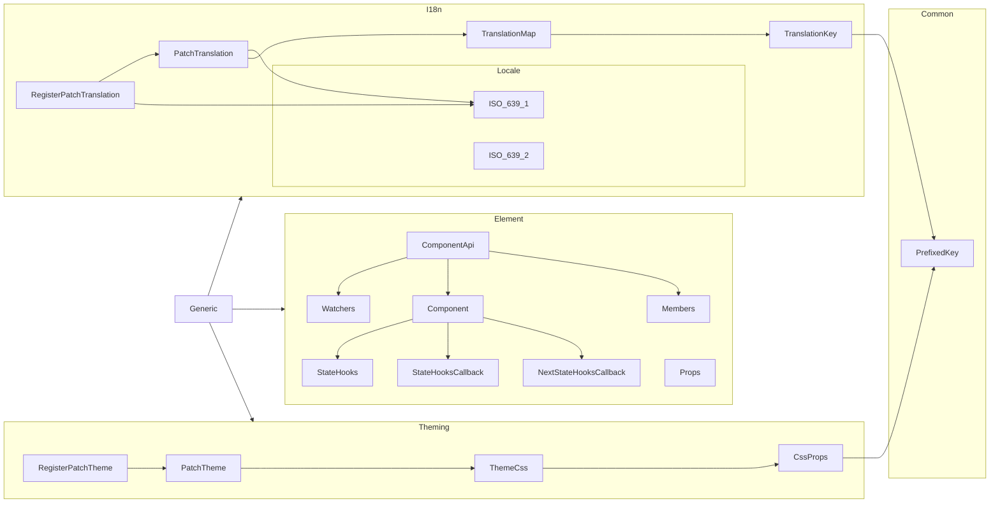
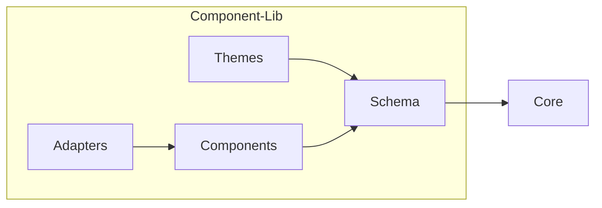

```
  ,---.    ,--.  ,--.                   ,--. ,--. ,--.
 /  O  \  /   | /   | ,--. ,--. ,-----. |  | |  | |  |
|  .-.  | `|  | `|  |  \  '  /  '-----' |  | |  | |  |
|  | |  |  |  |  |  |   \   '           '  '-'  ' |  |
`--' `--'  `--'  `--' .-'  /             `-----'  `--'
    the accessible    `---'   web component library
```

# A11y-UI Core

## Component




## Pattern


